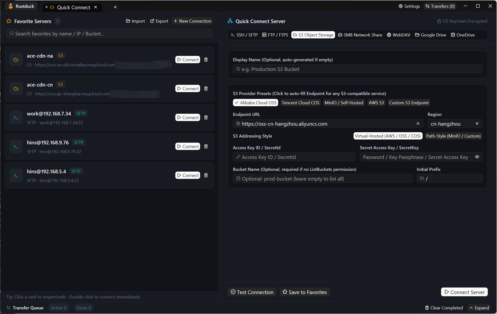
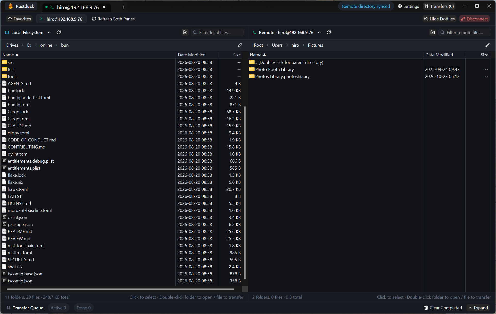

<div align="center">


# Rustduck

**Where servers, object buckets, and cloud drives feel like one native filesystem.**

A modern, GPU-accelerated cross-protocol file transfer studio crafted in **100% pure Rust** and **GPUI**.

[**简体中文**](./README.zh-CN.md) · [**License: MIT**](./LICENSE)

</div>

---

## Preview

<p align="center">
  
  <br />
  <sub><b>Favorites & Quick Connect Inspector</b> — Manage multi-protocol servers, cloud buckets, and OS keychain-protected credentials in one place.</sub>
</p>

<p align="center">
  
  <br />
  <sub><b>Dual-Pane Native Transfer Workspace</b> — Side-by-side local and remote OS-native virtualized file lists with drag-and-drop and real-time transfer queue.</sub>
</p>

---

## Why Rustduck?

Modern infrastructure is fragmented across Linux servers (`SSH / SFTP`), cloud object storage (`S3 / OSS / COS / R2 / MinIO`), enterprise file shares (`SMB / NAS`, `FTP / FTPS`, `WebDAV`), and personal cloud drives (`Google Drive`, `OneDrive`).

Yet the tools we use every day to move data between them are stuck at two extremes:
- **Legacy desktop clients** built two decades ago with dated interfaces, clunky modal workflows, or heavy Java/runtime dependencies.
- **Bloated Electron wrappers** that consume hundreds of megabytes of RAM just to render a directory listing and lag when scrolling through thousands of files.

**Rustduck** was born from a simple conviction: **moving files across protocols should feel instantaneous, unified, and uncompromisingly native.**

---

## Core Philosophy

### 1. One Studio for Every Storage Layer
Whether you are inspecting logs over **SSH / SFTP**, publishing release artifacts to an **S3** bucket with custom Canned ACLs, mounting a home **SMB** NAS, or syncing folders with **Google Drive** and **OneDrive** through an HTTP/SOCKS5 proxy, every storage backend speaks the same clean, predictable dual-pane language.

### 2. GPU Chrome + OS-Native File Views
UI chrome should be fluid and expressive; file tables with 100,000+ entries should feel like your operating system's native file manager. Rustduck combines **GPUI**'s hardware-accelerated studio interface with virtualized OS-native file controls (**Win32 `SysListView32` (`LVS_OWNERDATA`)** on Windows and **AppKit `NSTableView`** on macOS) — delivering instant scrolling, native shell icons, marquee multi-selection, and direct drag-and-drop between panes or your desktop.

### 3. Pure Rust, Zero External C/OpenSSL Baggage
Every protocol engine in Rustduck is implemented in memory-safe async Rust (`tokio` + `rustls`). There is no OpenSSL DLL hell, no WebView runtime, and no background daemon — just a single, fast native binary.

### 4. Security by Default
Connection metadata and bookmarks live in clean JSON so you can back them up or migrate them across machines, while passwords, SSH passphrases, S3 Secret Keys, and OAuth refresh tokens are locked inside your **OS-native credential vault** (**Windows Credential Manager** / **macOS Keychain**).

---

## Supported Protocols

| Protocol | Highlights |
| :--- | :--- |
| **SSH / SFTP** | Password & Ed25519 / RSA private key authentication (`~/.ssh/` expansion), streaming directory listing & recursive transfers |
| **FTP / FTPS** | Plain FTP & explicit/implicit TLS (`rustls`), passive-mode streaming uploads and downloads |
| **S3 Object Storage** | Built-in presets for **AWS S3**, **Alibaba Cloud OSS**, **Tencent Cloud COS**, **MinIO**, and any custom S3-compatible endpoint; Virtual-Hosted & Path-Style addressing; configurable default upload Canned ACL (`x-amz-acl`); automatic single-PUT & 8 MiB concurrent multipart upload |
| **SMB (v2 / v3)** | Pure-Rust SMB2/3 client for Windows File Shares, Samba, and Synology / QNAP NAS |
| **WebDAV** | Nextcloud, ownCloud, Synology WebDAV, and standard HTTP/HTTPS `PROPFIND` / `PUT` / `MKCOL` servers |
| **Google Drive** | One-click browser OAuth 2.0 loopback login, built-in HTTP / HTTPS / SOCKS5 proxy support |
| **OneDrive** | Microsoft Graph API v1.0 with browser OAuth 2.0 PKCE loopback login and proxy support |

---

## Getting Started

### Prerequisites
- **Rust** `1.85+` (`edition = "2021"`)
- **Windows 10 / 11** or **macOS 12+**

### Build & Run

```bash
# Run in development mode
cargo run

# Build optimized release binary
cargo build --release
```

---

## License

Released under the [MIT License](./LICENSE).
