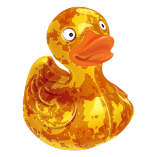

<div align="center">
  
  <h1>Rustduck</h1>
  <p><strong>A Pure-Rust, GPU-Accelerated Cloud & Remote File Transfer Client</strong></p>
  <p>Inspired by <em>Cyberduck</em> &amp; <em>Panic Transmit 5</em> — Built with Zed's <code>gpui</code> + <code>gpui-component</code></p>
  <p>
    <strong>English</strong> · <a href="README.zh-CN.md">简体中文</a>
  </p>
</div>

---

## Overview

**Rustduck** is a fast, native cloud and remote file transfer desktop application written in **100% pure Rust**. It combines the iconic spirit of Cyberduck (reimagined with a weathered, oxidized iron *"Rusty Duck"* emblem) with the refined dual-pane workflow and visual precision of **Panic Transmit 5**.

Powered by Zed's GPU-accelerated UI framework (`gpui` + `gpui-component`) and an asynchronous `tokio` storage runtime, Rustduck delivers zero-lag file browsing and streaming transfers across **SSH/SFTP**, **S3-Compatible Object Storage**, and **SMB2/SMB3 Network Shares** without relying on C/C++ protocol bindings or OpenSSL.

---

## Key Features

- **Pure-Rust Multi-Protocol Storage Engine**
  - **SSH / SFTP (`russh` + `russh-sftp`)**: Password and private key (`~/.ssh/id_ed25519`, `~/.ssh/id_rsa`, with `~/` tilde expansion) authentication over pure-Rust SSH2/SFTP v3.
  - **Generic S3 Object Storage (`reqwest` + `rustls` + AWS SigV4)**: Built-in provider presets for **Alibaba Cloud OSS**, **Tencent Cloud COS**, **MinIO**, **AWS S3**, and **Custom S3 Endpoints**. Supports both `Virtual-Hosted` and `Path-Style` addressing, root-level multi-bucket enumeration (`ListAllMyBuckets`), restricted single-bucket direct mounting, recursive directory deletion, and streaming `UNSIGNED-PAYLOAD` uploads.
  - **SMB2 / SMB3 Network Shares (`smb`)**: Pure-Rust SMB client supporting UNC path normalization, custom ports, and optional Workgroup/Domain authentication.
- **Panic Transmit 5-Inspired Dual-State Workspace**
  - **Custom Borderless TitleBar + Multi-Tab Sessions**: Native GPUI `TitleBar` hosting folder-style session tabs (`TabBar`), status indicators, and quick preference controls while preserving the OS taskbar window title.
  - **New Tab View (Favorites Gallery + Quick Connect Inspector)**: Searchable saved server cards on the left (click to inspect, double-click to connect) paired with a protocol-aware configuration inspector and live connection tester on the right.
  - **Connected Dual-Pane Browser**: Resizable **Local Filesystem** + **Remote Server** panes with interactive path breadcrumbs, manual path jump bar, inline folder creation/renaming/deletion confirmation, dotfile toggling, column sorting (`Name`, `Date Modified`, `Size`), and real-time filtering.
  - **Transfer Queue Drawer**: Concurrent background transfer engine (`tokio::io::duplex` streaming with semaphore concurrency limits), recursive folder uploads/downloads, live throughput & progress bars, and mid-stream **Pause / Resume / Cancel**.
- **OS Keychain Credential Security**
  - Server bookmarks are stored in `bookmarks.json` **without plaintext passwords or secret keys**. Sensitive credentials are encrypted via the native OS Keychain (`keyring`: Windows Credential Manager, macOS Keychain, or Linux Secret Service).
- **Bilingual i18n (`English` / `简体中文`)**
  - Automatically detects your operating system language on first launch (`en-US` or `zh-CN`), persists your preference to `preferences.json`, and allows instant live language switching in the Settings modal.
- **Adaptive Themes (`System` / `Light` / `Dark`)**
  - Follows your OS appearance (`System`) on first launch and supports instant switching between **System**, **Light Studio**, and **Dark Carbon** themes in the Settings modal, alongside an **About** page with version info.
- **Platform-Native Rusty Duck Icons**
  - **Windows**: Transparent-background multi-size `.ico` (`assets/icons/windows/rustduck.ico`) embedded directly into the executable via `build.rs` (Win32 Resource ID `1`).
  - **macOS / iOS / Android**: White rounded-rectangle (squircle) icons (`assets/icons/macos/rustduck.icns`, `assets/icons/ios/AppIcon_1024.png`, `assets/icons/android/ic_launcher_512.png`).

---

## Project Structure

```text
Rustduck/
├── assets/icons/               # Platform-specific Rusty Duck icons
│   ├── brand_logo.png          # In-app TitleBar emblem (transparent)
│   ├── windows/                # Transparent Windows .ico & PNGs
│   ├── macos/                  # White squircle macOS .icns & 1024px PNG
│   ├── ios/                    # iOS AppIcon_1024.png
│   └── android/                # Android ic_launcher_512.png
├── build.rs                    # Pure-Rust Win32 .res icon compiler & stack configuration
├── src/
│   ├── main.rs                 # GPUI application entrypoint
│   ├── lib.rs                  # Library root
│   ├── i18n.rs                 # Bilingual (en-US / zh-CN) translations
│   ├── models/                 # Protocol configs, Bookmark, FileEntry, TransferTask
│   ├── services/
│   │   ├── bookmark_store.rs   # JSON bookmark persistence + OS Keyring vault
│   │   ├── preferences.rs      # Language & Theme preferences + OS detection
│   │   ├── runtime.rs          # Global multi-threaded Tokio runtime
│   │   └── transfer_manager.rs # Concurrent streaming transfer queue
│   ├── storage/
│   │   ├── mod.rs              # StorageBackend trait & backend factory
│   │   ├── local.rs            # Local filesystem driver (with Windows drive root)
│   │   ├── sftp.rs             # Pure-Rust SSH/SFTP backend
│   │   ├── s3.rs               # Generic S3 / OSS / COS / MinIO backend
│   │   └── smb.rs              # Pure-Rust SMB2/3 backend
│   └── ui/
│       ├── mod.rs              # Light/Dark palettes, semantic file icons & assets
│       ├── workspace.rs        # Custom TitleBar, tab management & session state
│       ├── new_tab_view.rs     # Favorites Gallery + Quick Connect Inspector
│       ├── dual_pane_view.rs   # Resizable Local/Remote Dual-Pane File Browser
│       ├── file_pane.rs        # Sorting, filtering & breadcrumb path helpers
│       ├── settings_modal.rs   # Settings (Theme & Language) & About modal
│       └── transfer_drawer.rs  # Bottom collapsible transfer activity drawer
```

---

## Getting Started

### Prerequisites

- **Rust Toolchain**: Rust `1.85+` (2021 edition)
- **Windows**: MSVC Build Tools (`x86_64-pc-windows-msvc`) and Windows 10/11 SDK (DirectX 11/12 for GPUI hardware acceleration)

### Build & Run

```bash
# Run in development mode
cargo run

# Build debug binary
cargo build

# Build optimized release binary
cargo build --release

# Run all unit tests
cargo test --lib
```

---

## Configuration & Storage Locations

Rustduck stores non-sensitive configuration files in your platform's standard config directory (`%APPDATA%\rustduck\` on Windows, `~/Library/Application Support/rustduck/` on macOS, `~/.config/rustduck/` on Linux):

- **`bookmarks.json`**: Saved server profiles (endpoints, hosts, usernames, buckets). **Never contains plaintext secrets.**
- **`preferences.json`**: UI language (`"en-US"` / `"zh-CN"`) and theme preference (`"system"` / `"light"` / `"dark"`).
- **OS Keychain (`service = "rustduck"`)**: Encrypted passwords, SSH key passphrases, and S3 `SecretAccessKey` values keyed by bookmark UUID.
